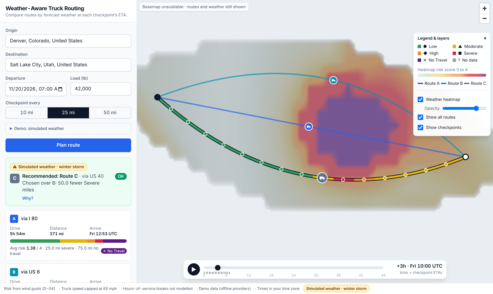
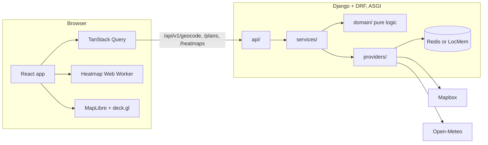

# Weather-Aware Truck Routing

Live app: _not deployed yet_ · API health: _`<backend>/api/v1/health`_ · Walkthrough: _Loom not recorded yet_

Compare 3 truck routes by forecast weather at the time the truck reaches each checkpoint,
then pick the safest one using wind, rain and snow thresholds and load weight rules.



<sub>Screenshot from the production build with offline providers and the `winter_storm` scenario. The
basemap was unreachable where it was taken, so the map shows the plain fallback background.</sub>

## How it works (60 seconds)
1. Mapbox gives up to 3 routes. If fewer than 3 are distinct, more are generated through
   perpendicular via-points and deduplicated by geometric overlap (D-13).
2. Checkpoints every 10/25/50 miles get an ETA from the route's segment durations, with the truck
   speed capped at 65 mph (D-06, D-07).
3. Open-Meteo hourly forecasts are looked up at each checkpoint's ETA, using the hour bucket that
   *ends* at or after the ETA (D-08). One batched request covers every checkpoint of every route.
4. Each checkpoint is classified Low to No Travel. Load rules raise the wind level only (D-01 to D-03).
5. Each checkpoint owns the road halfway to its neighbours (D-09). Routes are ranked by
   No Travel miles, Severe miles, High miles, average risk, then travel time (D-11).
6. A 0 to 48 h heatmap along the corridor uses the same scoring function, so map colours and
   checkpoint levels never disagree (D-15).

## Key decisions
| ID | Decision |
|---|---|
| D-01 | Half-open bands with an inclusive lower bound; rain/snow No Travel is strictly `>` 1.00 / 3.0 |
| D-04 | Wind risk uses **gusts**, not sustained wind (configurable with `RISK_WIND_METRIC`) |
| D-08 | The forecast value stamped T covers (T-1h, T], so an ETA uses `ceil_to_hour(eta)` |
| D-09 | A checkpoint owns the road from the midpoint with its previous neighbour to the midpoint with its next one |
| D-11 | Ranking key `(no_travel_mi, severe_mi, high_mi, avg_risk, minutes, id)`, rounded first. No Travel comes first even though the brief doesn't list it |
| D-13 | Never pad to 3 with near-duplicates; warn `ONLY_N_DISTINCT_ROUTES` instead |
| D-14 | Slider runs from departure +0 h to +48 h, with crossfade between hours |

Full list and reasoning: [docs/01-SPEC.md](docs/01-SPEC.md).

The ranking is strict, as the brief orders it: one fewer Severe mile beats a 2-hour longer drive.
The reasons text in the banner states the trade-off ("Chosen over B: 25.0 fewer Severe miles").

## Run locally
Requirements: Python 3.12 with [uv](https://docs.astral.sh/uv/), Node 20+ with pnpm.

```bash
cp .env.example .env          # set MAPBOX_TOKEN, or PROVIDERS=fake to run fully offline
make install
make dev-backend              # Django on :8000
make dev-frontend             # Vite on :5173, proxies /api to :8000
```

`PROVIDERS=fake` uses deterministic routes and weather, so the whole app runs without any
token or network access. To demo every risk level, open **Demo: simulated weather** in the form
and pick a scenario (D-20). A "Simulated weather" badge stays on screen while it is active.

## Tests
```bash
make check      # ruff, mypy (strict on domain), import-linter, pytest + coverage, schema drift,
                # eslint/prettier, tsc, vitest, production build, bundle budgets
make coverage   # branch coverage for risk.py and ranking.py
```

- **Boundary tests:** every threshold edge from the spec table (24.99 / 25.0, 30,000 / 30,001 lb and
  so on). They run in the domain and again through `POST /plans`.
- **Property tests (Hypothesis):** monotonic in each input and in load; overall >= every component;
  `floor(heatmap score) == level`; scalar and vectorized scoring agree on 30k random inputs.
- **Golden scenarios:** 6 hand-written cases (Severe decides, High decides, average risk decides,
  duration decides, no safe route, load rule flips the winner). They run in the domain and end to end
  through the API.
- **Provider adapters:** respx tests for retries, `Retry-After`, lon/lat order, unit conversion,
  nulls, chunking and caching. `pytest-socket` blocks the real network.
- **Frontend:** formatters, palette, polyline, truck interpolation, raster renderer and LUT, form
  validation, cards, banner variants, slider keyboard, error states, and a check that route cards
  don't re-render while the slider moves.

`risk.py` and `ranking.py` are at 100 % branch coverage, and the whole domain is at 100 %.

## Architecture


```
backend/planner/domain/     pure: levels, units, geo, eta, sampling, weather_lookup, risk,
                            attribution, ranking, alternatives, heatmap, scenarios
backend/planner/providers/  Mapbox routing + geocoding, Open-Meteo, fakes, shared HTTP client
backend/planner/services/   plan_service, heatmap_service
backend/planner/api/        serializers (D-17 validation), views, problem+json errors
frontend/src/features/      plan-form, routes, map, heatmap (worker, slider)
```

`import-linter` checks that the domain imports nothing from Django, httpx, the providers or the
services. Frontend types are generated from the drf-spectacular schema, and CI fails if they drift.

## Performance notes
- **Heatmap pipeline.** The API sends the 49-hour grid as base64 `uint8` (about 50 KB). A Web
  Worker turns it into one `ImageBitmap` per hour, sampled in Web Mercator space with mask-aware
  bilinear interpolation and a 201-entry colour lookup table. It renders the current hour first,
  then works outward. The bitmaps are transferred to the main thread and kept out of React state.
- **No network and no recompute on slider movement.** Dragging only swaps the `image` and
  `opacity` of two deck.gl `BitmapLayer`s (a crossfade) and moves the truck markers (binary search
  on the per-vertex `cum_time_s`). Only the slider and the map subscribe to the hour.
- **`Server-Timing`.** `/plans` and `/heatmaps` report `routing`, `weather`, `compute` and
  `serialize` durations, visible in devtools.
- **Bundle.** Initial JS is about 126 KB gzipped (budget 250). The map chunk (MapLibre plus deck.gl)
  is lazy-loaded.
- **Measured** on the production build with offline providers, in headless Chromium with software
  WebGL (no GPU): Lighthouse desktop performance 99, accessibility 96; all 49 bitmaps ready about
  0.3 s after the heatmap response. See [docs/QA-REPORT.md](docs/QA-REPORT.md).

## Deploy
- **Backend:** `render.yaml` (Render Blueprint with Redis) or `backend/Dockerfile` (Fly.io, Railway).
  It runs gunicorn with uvicorn workers and `config.settings.prod`. The health check is
  `/api/v1/health`, which reports the git SHA. Use an always-on plan; a cold start hurts the
  performance grade.
- **Frontend:** `frontend/vercel.json` or `frontend/netlify.toml` (SPA fallback, immutable asset
  caching). Set `VITE_API_BASE_URL=https://<backend>/api/v1`, and optionally `VITE_MAP_STYLE_URL`.
- Set `DJANGO_ALLOWED_HOSTS` and `CORS_ALLOWED_ORIGINS` to the real hosts. The Mapbox token stays
  server-side.

## Limitations and next steps
- Hours-of-service breaks are not modelled (S-02), and durations come from car routing with a
  65 mph cap, not truck routing.
- Forecasts more than 72 h out are flagged as low-confidence. Departures are limited to 7 days ahead.
- Sampling is discrete: at a 50 mi interval a narrow storm can fall between checkpoints. The
  heatmap shows what the checkpoints miss.
- The provider fixtures are synthetic, in the providers' exact response shape, because no key or
  network was available when they were written. Run `uv run python scripts/record_fixtures.py`
  with a token to replace them with real recordings.
- Open decisions are listed in [docs/QA-REPORT.md](docs/QA-REPORT.md#open-decisions).
- Stretch ideas: S-01 safer departure time, S-03 shareable URL, S-04 per-checkpoint sparkline.
