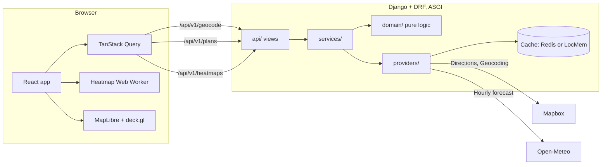
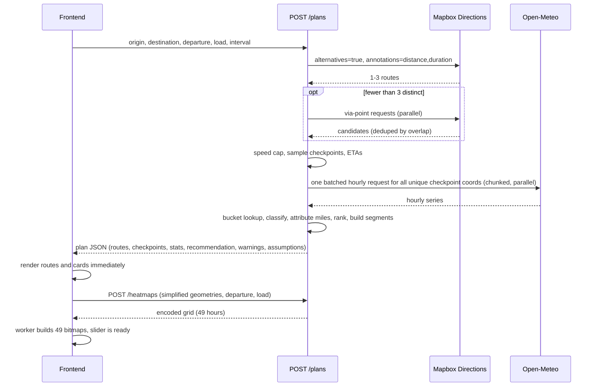

# 02. Architecture

## 1. System overview



**Principles**
- Thin views, thin providers, fat pure domain. All grading-critical logic lives in `domain/` and is unit tested without a network or Django.
- The backend is stateless. Any instance can serve any request. The heatmap request carries the route geometry, so it doesn't depend on a cached plan.
- The browser never talks to Mapbox routing or Open-Meteo directly. Keys stay on the server, responses get cached, and the frontend only knows one contract.
- The plan arrives first and the heatmap loads after it. The user sees routes and the recommendation before the heavier heatmap is ready.

## 2. Backend modules

```
backend/planner/
├── domain/
│   ├── models.py          # frozen dataclasses: LatLon, RouteGeometry, Route, Checkpoint, WeatherSample, RiskResult, RouteStats, Plan
│   ├── levels.py          # Level IntEnum, thresholds as constants (single source)
│   ├── units.py           # kmh_to_mph, mm_to_in, cm_to_in, m_to_mi, lb_to_t
│   ├── geo.py             # haversine, cumulative distance, interpolate_along, simplify, overlap_ratio, corridor
│   ├── eta.py             # speed cap, cumulative time array
│   ├── sampling.py        # checkpoint positions and ETAs
│   ├── weather_lookup.py  # pick the hourly bucket for an ETA (D-08)
│   ├── risk.py            # classify_wind/rain/snow, apply_load_rules, classify_checkpoint, continuous_score
│   ├── attribution.py     # owned miles per checkpoint, route stats, risk segments
│   ├── ranking.py         # ranking key, recommendation, reasons text
│   ├── alternatives.py    # via-point candidates, dedupe by overlap
│   ├── heatmap.py         # grid build, vectorized scoring, encoding
│   └── scenarios.py       # synthetic weather overlays (D-20)
├── providers/
│   ├── base.py            # Protocols: RoutingProvider, GeocodingProvider, WeatherProvider
│   ├── http.py            # shared httpx.AsyncClient, retries, timeouts, Server-Timing capture
│   ├── mapbox_routing.py
│   ├── mapbox_geocoding.py
│   ├── open_meteo.py
│   └── fakes.py           # deterministic fakes for tests and offline dev
├── services/
│   ├── plan_service.py    # route -> sample -> weather -> classify -> attribute -> rank
│   └── heatmap_service.py # corridor -> grid -> weather -> score -> encode
└── api/
    ├── serializers.py     # request validation (D-17) and response shapes
    ├── views.py           # async APIViews
    ├── errors.py          # domain errors -> RFC 7807 problem+json
    └── urls.py
```

**Dependency direction:** `api -> services -> (domain, providers)`, and `providers -> domain.models/units`. Domain imports nothing from the others. CI enforces this with `import-linter`.

## 3. Request flow: create a plan



## 4. API contract (v1)

All endpoints are under `/api/v1`. JSON only. Errors use `application/problem+json`.

### `GET /geocode?q=denver&limit=5`
```json
{ "results": [ { "id": "dXJuOm1ieHBsYzpB", "label": "Denver, Colorado, United States", "lat": 39.7392, "lon": -104.9903 } ] }
```

### `POST /plans`
Request:
```json
{
  "origin":      { "lat": 39.7392, "lon": -104.9903, "label": "Denver, CO" },
  "destination": { "lat": 40.7608, "lon": -111.8910, "label": "Salt Lake City, UT" },
  "departure_time": "2026-11-20T06:00:00-07:00",
  "load_weight_lb": 42000,
  "sample_interval_mi": 25
}
```
Optional query param: `?scenario=winter_storm` (D-20).

Response (abridged):
```json
{
  "plan_id": "pln_01JD...",
  "generated_at": "2026-11-19T20:11:03Z",
  "assumptions": { "wind_metric": "gust", "truck_max_speed_mph": 65, "hos_breaks": false, "scenario": null },
  "routes": [
    {
      "id": "A",
      "label": "via I-80 W",
      "source": "provider",
      "distance_mi": 525.4,
      "duration_s": 29160,
      "arrival_time": "2026-11-20T21:06:00Z",
      "geometry": "polyline6 (simplified, <= 2,000 vertices)",
      "cum_time_s": [0, 41.2, 97.8, "... one per simplified vertex, used for the truck marker"],
      "risk_segments": [ { "level": "HIGH", "from_mi": 112.5, "to_mi": 162.5, "geometry": "polyline6..." } ],
      "checkpoints": [
        {
          "index": 3, "mile": 75.0, "lat": 40.12, "lon": -106.40,
          "eta": "2026-11-20T14:21:00Z", "forecast_hour": "2026-11-20T15:00:00Z",
          "weather": { "wind_mph": 22.1, "gust_mph": 38.4, "rain_in_hr": 0.0, "snow_in_hr": 0.62 },
          "levels": { "wind": "SEVERE", "rain": "LOW", "snow": "MODERATE", "overall": "SEVERE" },
          "dominant_factor": "wind",
          "load_adjusted": true,
          "owned_mi": 25.0,
          "low_confidence": false
        }
      ],
      "stats": {
        "miles_by_level": { "LOW": 300.1, "MODERATE": 100.0, "HIGH": 75.3, "SEVERE": 50.0, "NO_TRAVEL": 0.0 },
        "avg_risk": 0.82,
        "max_level": "SEVERE"
      },
      "rank": 1,
      "recommended": true
    }
  ],
  "recommendation": {
    "route_id": "A",
    "status": "OK",
    "reasons": [ "Chosen over B: 25.0 fewer Severe miles", "Chosen over C: same Severe and High miles, lower average risk (0.82 vs 1.10)" ]
  },
  "warnings": [ { "code": "ONLY_N_DISTINCT_ROUTES", "detail": "Only 2 distinct routes exist for this trip." } ]
}
```

### `POST /heatmaps`
Request:
```json
{ "routes": ["polyline6...", "polyline6..."], "departure_time": "2026-11-20T13:00:00Z", "load_weight_lb": 42000, "scenario": null }
```
Response:
```json
{
  "grid": { "lat0": 38.9, "lon0": -112.4, "dlat": 0.15, "dlon": 0.15, "rows": 24, "cols": 52 },
  "hours": ["2026-11-20T13:00:00Z", "... 49 entries"],
  "mask": "base64 bitset rows*cols",
  "scores": "base64 Uint8Array length 49*rows*cols, value = floor(score*50), 255 = no data",
  "encoding": { "scale": 50, "no_data": 255 }
}
```

### `GET /health`
Returns `{ "status": "ok", "version": "<git sha>" }`.

### Error format
```json
{ "type": "https://errors.app/no-route", "title": "No route found", "status": 422, "code": "NO_ROUTE", "detail": "Mapbox found no drivable route between the points." }
```

| Code | HTTP | When |
|---|---|---|
| `VALIDATION_ERROR` | 400 | Input fails D-17 |
| `GEOCODE_NOT_FOUND` | 404 | No geocoding results |
| `NO_ROUTE` | 422 | Provider finds no route |
| `ROUTE_TOO_LONG` | 422 | Over 3,000 miles |
| `PROVIDER_UNAVAILABLE` | 503 | Retries exhausted on Mapbox or Open-Meteo |
| `RATE_LIMITED` | 429 | DRF throttle hit |

## 5. Caching

| What | Key | TTL |
|---|---|---|
| Geocode | `geo:{normalized query}:{limit}` | 24 h |
| Directions | `rt:{o}:{d}:{depart hour}:{max_weight}` (coords rounded to 4 dp) | 30 min |
| Weather series | `wx:{lat2}:{lon2}:{start_hour}:{end_hour}` (coords rounded to 2 dp, about 1 km) | 30 min |

The backend is Redis when `REDIS_URL` is set, otherwise `LocMemCache`. The app is correct without any cache. Caching only makes it faster.

## 6. Concurrency

- Django runs under ASGI (uvicorn workers), and views are `async def`.
- One shared `httpx.AsyncClient` per process, with HTTP/2 on, an 8 second timeout, and connection pooling.
- Via-point route requests and weather chunks run through `asyncio.gather` behind a semaphore (max 4 concurrent per provider).
- Retries: up to 2 retries on timeouts, 429 and 5xx, with exponential backoff (0.3 s, 0.9 s) and jitter. Respect `Retry-After`.

## 7. Configuration

`.env.example`:
```
DJANGO_SECRET_KEY=change-me
DJANGO_DEBUG=false
DJANGO_ALLOWED_HOSTS=localhost,127.0.0.1
CORS_ALLOWED_ORIGINS=http://localhost:5173
MAPBOX_TOKEN=
OPEN_METEO_BASE_URL=https://api.open-meteo.com/v1/forecast
OPEN_METEO_API_KEY=            # only for commercial plans
REDIS_URL=                     # optional
RISK_WIND_METRIC=gust          # gust | sustained (D-04)
TRUCK_MAX_SPEED_MPH=65         # 0 disables (D-07)
HEATMAP_CORRIDOR_KM=40         # D-16
HEATMAP_MAX_POINTS=450
MAPBOX_USE_MAX_WEIGHT=false    # pass gross weight to Mapbox max_weight
TRACTOR_TRAILER_TARE_LB=35000  # used only when MAPBOX_USE_MAX_WEIGHT=true
```
Frontend: `VITE_API_BASE_URL`, `VITE_MAP_STYLE_URL`.

## 8. Security

- `DEBUG=false` in production, secret key from the environment, `SECURE_*` headers on, HTTPS only.
- CORS is an allowlist (only the frontend origin).
- DRF throttling: 30 requests per minute per IP on `/plans` and `/heatmaps`, 120 per minute on `/geocode`.
- Payload limits: the heatmap request accepts at most 3 routes and at most 5,000 points per decoded route.
- Provider error text is never forwarded raw to the client.

## 9. Observability

- Structured JSON logs with `request_id`, route count, checkpoint count, and provider latencies.
- The `Server-Timing` header on `/plans` and `/heatmaps` (`routing;dur=…, weather;dur=…, compute;dur=…`) makes performance visible in browser devtools. It's a good thing to show in the Loom.
- `/health` includes the git SHA so the deployed version is easy to confirm.

## 10. Deployment topology

- Backend: Render, Railway or Fly.io web service running `gunicorn config.asgi:application -k uvicorn.workers.UvicornWorker -w 2`. Static files go through WhiteNoise. SQLite is fine because nothing is persisted.
- Frontend: Vercel or Netlify static build with `VITE_API_BASE_URL` pointing at the backend.
- Make sure the backend doesn't go to sleep while reviewers are testing it (avoid free tiers that sleep, or keep it warm). A cold start of 30+ seconds will hurt the performance grade.
